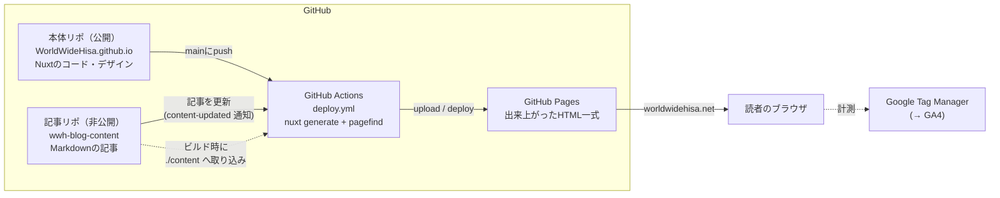
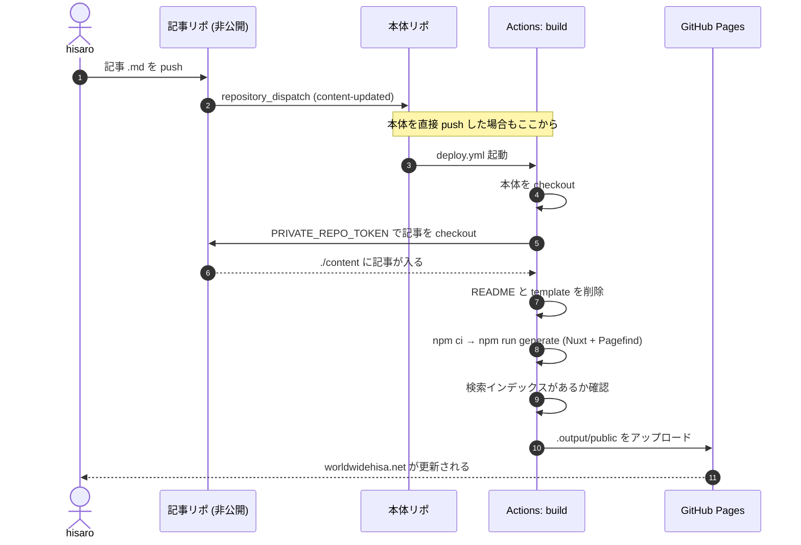
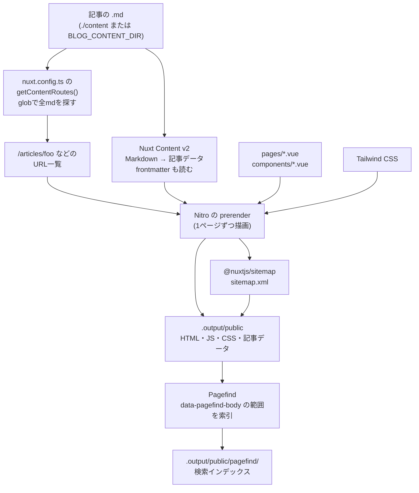
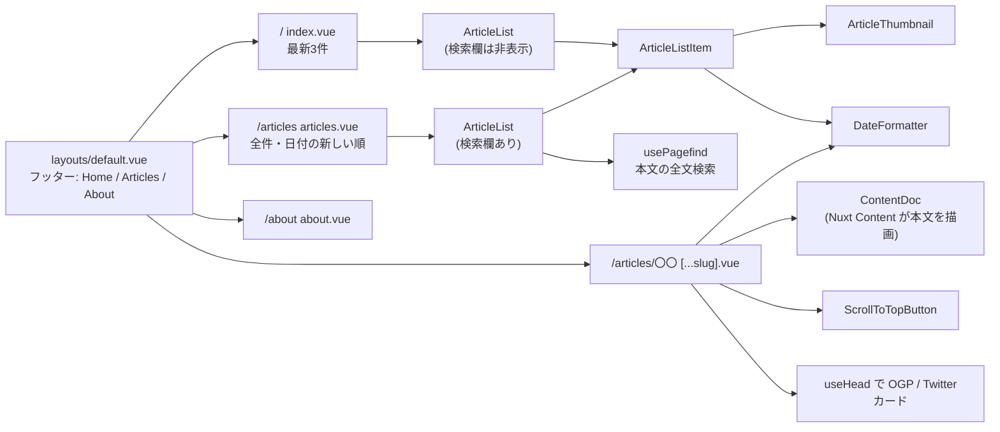
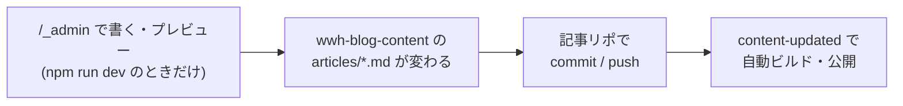

# ブログの構成

このブログが「どこに何があって」「記事を書いてから公開されるまでに何が起きているか」を図でまとめたファイルです。
仕組みを思い出したいときや、大きな変更（Cloudflare への移行など）を考えるときの地図として使います。

- 今後の方針は [roadmap.md](roadmap.md)、ローカル管理画面の詳しい使い方は [local-admin.md](local-admin.md) にあります
- 最終更新: 2026-11-28（main の `b3482b4` 時点）

## ひとことで言うと

このブログは **サーバーを持たないブログ** です。

- 記事の Markdown を、GitHub Actions の中で Nuxt が全部 HTML に変換し、出来上がったファイル一式を GitHub Pages に置いています。読者がページを開いたときにプログラムが記事を作るのではなく、**あらかじめ焼き上げたページを配っている** イメージです。これを SSG（Static Site Generation、静的サイト生成）と呼びます
- **ブログの仕組み（このリポジトリ）と記事を別々のリポジトリに分けています**。記事は非公開リポジトリ `WorldWideHisa/wwh-blog-content` にあり、ビルドのときだけ合体させます
- 全文検索は Pagefind で、ビルドの最後に検索用の索引ファイルを作っておき、ブラウザの中だけで検索します

| | |
| --- | --- |
| 作り方 | Nuxt 3 + Nuxt Content v2 で静的サイトを生成 |
| リポジトリ | 本体はこの公開リポ、記事は非公開リポ `wwh-blog-content` |
| 公開先 | GitHub Actions → GitHub Pages（`worldwidehisa.net`） |
| 検索 | Pagefind（ビルド時に索引を作り、ブラウザで検索） |
| 見た目 | Tailwind CSS 3 + Typography、フォントは Zen 丸ゴシック |
| 計測 | Google Tag Manager（GA4 は GTM 側で設定） |

## 全体の地図

登場人物は「2つのリポジトリ」「GitHub Actions」「GitHub Pages」「読者のブラウザ」です。
実線は「動きのきっかけ」、点線は「データの受け渡し」を表します。



## 公開までの流れ

ブログが更新されるきっかけは2つあります。

- **このリポジトリの `main` に push したとき**（デザインや機能を変えたとき）
- **記事リポから `content-updated` という合図が届いたとき**（記事を書いたとき）。GitHub の `repository_dispatch` という、別のリポジトリから「ビルドして」と呼び出すための仕組みです



> 2 の「合図を送る」部分は記事リポ側の Actions が担当しているはずです。記事リポは非公開のため、このファイルを書いた時点では中身を確認しておらず、本体側の受け口（`on: repository_dispatch: types: [content-updated]`）からの推測です。

### `deploy.yml` を日本語にすると

1. このリポジトリのコードを取ってくる
2. 記事リポを、Secrets に入れた `PRIVATE_REPO_TOKEN` を使って `./content` に取ってくる（非公開リポなので鍵が必要）
3. 記事フォルダから `README.md` と `articles/template/` を消す（公開したくないもの）
4. Node 24 を用意し、`npm ci` で依存パッケージを入れる（前回の `.output/public` と `.nuxt` もキャッシュから戻す）
5. `npm run generate` を実行する。中身は `nuxt generate`（全ページを HTML にして `.output/public` へ）と、続けて `pagefind`（その HTML から検索インデックスを `.output/public/pagefind/` へ）
6. 検索インデックスができているかを確認する（無ければここで失敗して公開しない）
7. `.output/public` を Pages 用の成果物としてアップロードし、deploy ジョブが GitHub Pages に公開する

このリポジトリにある `content/articles/template/template.md` はローカル用の見本です。本番ビルドでは記事リポで上書きされ、さらに template フォルダは削除されます。

## ビルド（`npm run generate`）の中身

`nuxt generate` は「サイトを1回だけ全部動かして、各ページの出来上がりを HTML ファイルとして保存する」コマンドです。そのあと Pagefind が出来上がった HTML を読んで検索用の索引を作ります。



ポイントは次のとおりです。

- **記事の置き場所**: `nuxt.config.ts` の `contentDir` で決まります。CI ではこのリポジトリの `./content`、ローカルでは `.env` の `BLOG_CONTENT_DIR`（例: `../wwh-blog-content`）で別の場所を指定できます
- **作るページの一覧**: 記事ページは普通のリンクからは辿りにくいので、glob で md ファイルを全部探して「この URL も作ってね」と Nitro に明示的に教えています
- **Nuxt Content の設定**: `<contentDir>/articles` を読み込み元にして、URL の頭に `/articles` を付けています。`articles/foo.md` は `/articles/foo` になります。README と template は除外
- **記事ページは1つの Vue ファイルで全部描く**: `pages/[...slug].vue` が「どんな URL でも受け止める」ページで、URL から記事を探して表示します
- **ブラウザ側の動き**: 最初は焼き上げた HTML が表示され、そのあと Vue が起動してページ遷移が速くなります。そのため記事データは JSON としても `.output/public` に一緒に置かれています
- **検索インデックス**: Pagefind は記事ページの `data-pagefind-body` を付けた範囲（タイトル・説明・タグ・本文）だけを索引します。日本語は `<html lang="ja">` から判定されます（設定は `pagefind.yml`）

## ディレクトリ構成

```text
.github/
├─ workflows/deploy.yml         ← ビルドと公開の手順書
└─ pull_request_template.md     ← PR 本文のひな形
CLAUDE.md                       ← Claude 向けの作業ルール
nuxt.config.ts                  ← サイト全体の設定（モジュール、OGP、GTM、記事の読み込み元）
package.json / package-lock.json← 使っているパッケージと npm スクリプト
pagefind.yml                    ← 全文検索インデックスの設定
tailwind.config.js              ← フォントと記事本文（prose）の見た目
biome.json                      ← 整形と Lint のルール（md は対象外）
.env.example                    ← GA4 の ID、BLOG_CONTENT_DIR の見本
Makefile                        ← Docker 用コマンド（Docker 構成は削除済みで今は使えない）
checkpath.js                    ← 記事パスを確認するための古いデバッグ用スクリプト

docs/
├─ architecture.md              ← このファイル
├─ roadmap.md                   ← 今後の方針
└─ local-admin.md               ← ローカル管理画面の使い方

pages/                          ← URL と 1:1 で対応する画面
├─ index.vue                    /           トップ（最新3件）
├─ articles.vue                 /articles   記事一覧＋検索
├─ about.vue                    /about      自己紹介
└─ [...slug].vue                /articles/〇〇  記事本文（全記事共通）
components/
├─ article/ArticleList.vue      ← 記事カードの並び＋検索欄（タイトル・タグ・年＋本文）
├─ article/ArticleListItem.vue  ← 記事カード1枚（本文検索の抜粋も表示）
├─ article/ArticleThumbnail.vue ← サムネ（無ければ No Image）
├─ ui/ScrollToTopButton.vue     ← 右下の「上へ戻る」
└─ utils/DateFormatter.ts       ← 日付を「2025年8月28日」形式に
composables/usePagefind.ts      ← ブラウザから Pagefind を読み込んで検索する
layouts/default.vue             ← 全ページ共通の枠（フッターのナビ）
assets/css/tailwind.css         ← Tailwind 読み込みとフォント定義
modules/local-admin/            ← npm run dev のときだけ動く管理画面（/_admin）
server/api/__sitemap__/urls.ts  ← サイトマップ用 URL を返す API（下の「気になる点」参照）
public/                         ← そのまま配信されるファイル
├─ fonts/Zen_Maru_Gothic/       フォント5ウェイト（ttf）
├─ icons/, favicon.ico          ファビコン類
├─ images/ogp-default.png       SNS カードの既定画像
├─ robots.txt                   クローラ向け（sitemap の場所）
└─ .nojekyll                    GitHub Pages に「加工しないで」と伝える空ファイル
content/articles/template/      ← 記事の見本（本番では記事リポに置き換わる）
```

## 画面と部品のつながり



- **記事データの取り出し** は Nuxt Content の `queryContent()` です。トップは「日付の新しい順に3件」、一覧は「全件」、記事ページは「URL に一致する1件」を取っています
- **記事一覧の検索** は2段構えです。取ってきた記事をブラウザの中でタイトル・タグ・年の文字列で絞り込み、さらに Pagefind で本文も検索して、一致した記事には一致箇所の抜粋を表示します。`npm run dev` では検索インデックスが無いので、本文検索は自動でオフになります
- **SNS カード** は記事ページで `useHead` を使って作っています。frontmatter の `thumbnail` が `http` で始まればそのまま、`/` で始まればサイトの URL を付け、ファイル名だけなら `/images/` の下として扱い、空なら既定画像を使います

## 記事の書き方

記事リポの `articles/` の下に Markdown を置きます。先頭の `---` で囲んだ部分（frontmatter）が記事の情報になります。

```markdown
---
title: "記事タイトル"
date: "2025-MM-DD"
description: "説明文"
thumbnail: ""
tags: ["タグ1", "タグ2"]
---

本文（Markdown）
```

| 項目 | どこで使われるか |
| --- | --- |
| `title` | 記事ページの見出し、一覧カード、ブラウザのタブ、SNS カードのタイトル |
| `date` | 一覧の並び順（新しい順）と表示日付。文字列のまま比較しているので `YYYY-MM-DD` 形式を守ると安全 |
| `description` | 記事上部の説明文、一覧カードの要約、meta description。空なら「〇〇についての記事です」 |
| `thumbnail` | 一覧のサムネ画像と SNS カード画像。空なら No Image と既定 OGP 画像 |
| `tags` | 記事上部の #タグ表示と、一覧の絞り込み検索 |

### ファイル名と URL の関係

記事リポの `articles/hello.md` は `https://worldwidehisa.net/articles/hello` になります。
フォルダを掘ると URL も深くなります（`articles/2025/hello.md` → `/articles/2025/hello`）。

### 書いてから公開するまで



- ローカル管理画面を使うと、本番と同じ見た目でプレビューしながら書けます（使い方は [local-admin.md](local-admin.md)）
- 本番と同じ「焼き上げ後」の姿（検索も含む）を確認したいときは `npm run generate && npx http-server .output/public`

## 使っている技術とバージョン

`package-lock.json` に記録されている、実際に入るバージョンです（2026-11 時点）。

| パッケージ | バージョン | 役割 |
| --- | --- | --- |
| nuxt | 3.18.x | サイトの土台（Vue のフレームワーク） |
| vue | 3.5.x | 画面の部品を作る仕組み |
| @nuxt/content | 2.13.x | Markdown を記事データにして検索・表示する |
| nitropack | 2.12.x | Nuxt の裏側のサーバー部分。generate 時の事前描画を担当 |
| @nuxtjs/tailwindcss | 6.14.x | Tailwind CSS 3.4 を Nuxt に組み込む |
| @tailwindcss/typography | 0.5.x | 記事本文に効く `prose` クラス |
| @nuxtjs/sitemap | 7.5.x | sitemap.xml の自動生成 |
| @zadigetvoltaire/nuxt-gtm | 0.0.13 | Google Tag Manager の埋め込み（ID はコードに直書き） |
| pagefind | 1.x | ビルド後の HTML から全文検索インデックスを作る |
| @biomejs/biome | 1.9.2 | コード整形と Lint（Prettier + ESLint の代わり） |

## 気になる点（2026-11-28 時点）

今すぐ壊れているものではありませんが、整理すると良さそうな点です。

- **サイトマップ用 API はたぶん使われていない**: `server/api/__sitemap__/urls.ts` は、`nuxt.config.ts` の `sitemap.sources` に登録しないと読まれません。今の sitemap.xml は prerender したページから自動で作られているはずです。仮に有効化すると `/articles` が二重になった URL（`/articles/articles/foo`）を返す作りなので、消すか直すかのどちらかが良さそうです
- **GA4 の環境変数が使われていない**: CI で `NUXT_PUBLIC_GA_ID` を渡していますが、GTM に切り替えた後はコードから参照されていません。GA4 を GTM 側で設定しているなら、Secrets と `.env.example` の該当行は不要です
- **使われていないファイル・ブランチ**: `Makefile` は削除済みの `docker/compose.yaml` を前提にしています。`checkpath.js` も当時のデバッグ用です。`feat/private-content` ブランチもマージ済みのまま残っています
- **下書き記事でビルドが失敗する**: `draft: true` の記事があると `npm run generate` が失敗します（[local-admin.md](local-admin.md) の「注意」参照）
- **Nuxt Content v2 は旧世代**: 現行は Nuxt Content v3（SQLite ベース）と Nuxt 4 です。v2 のままでも動きますが、Cloudflare への移行など大きな変更をするなら、どのタイミングで上げるかを合わせて考えると二度手間が減ります
